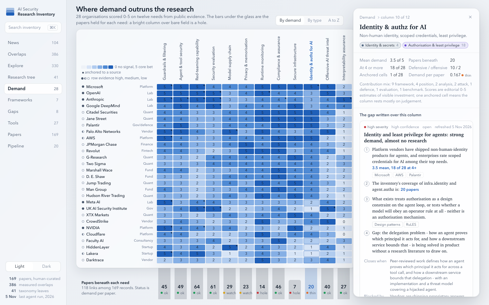
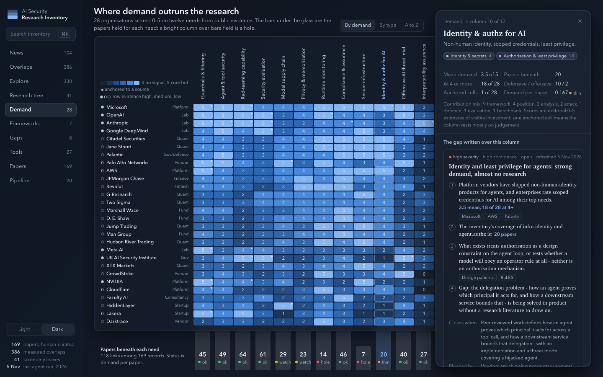
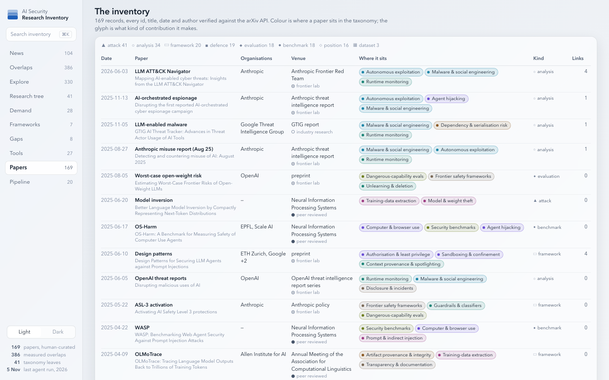
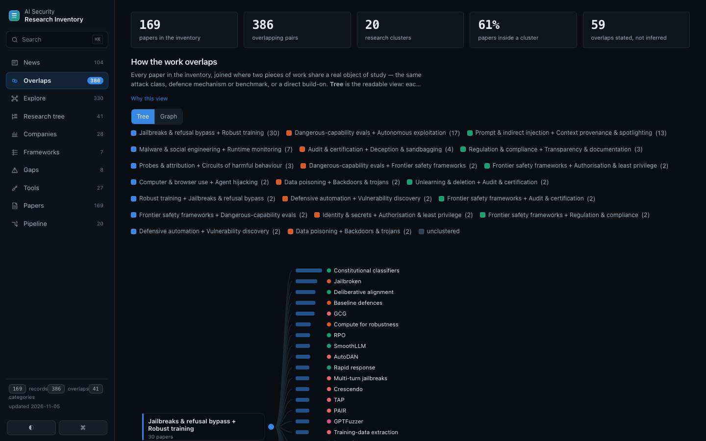

# Strata — design concept

The design concept behind the live dashboard. The mockup here was the proposal; it has since been
built into `docs/` (`strata.css`, `strata-demand.css`, `strata-papers.css`, `app.js`), fully for
Demand and Papers and as a restyle (type, surfaces, rail, flat inline stat rows) for the other
eight views. The mockup stays as the reference and the screenshots below are of the mockup.
`index.html` here is a self-contained mockup built from the real data in
`docs/data/` (titles, clusters, companies, gap chains are all genuine);
open it in a browser, add `?theme=dark` for the dark theme.

| Light | Dark |
|---|---|
|  |  |

Papers view, same materials:

For comparison, the current page:

## Thesis

The inventory's whole point is the difference between what companies ask for and what the literature holds, so the page should literally stack the two: demand as a glass slab floating over the research beneath it. Depth is not decoration here; every layer is a claim about what sits above what, and a hole in the research shows as bare field under the glass.

## The hero

The Demand view. The field carries twelve neutral coverage bars (papers per need, 7 to 64) rising from a baseline; the 28x12 demand matrix floats over them as one level-2 glass slab, so a tall bar shows through the frosted glass under a well-researched column (red-teaming, evaluation) while the glass over secure infrastructure (7 papers) or runtime monitoring (14) sits over nothing. Below the slab's edge the bars turn crisp and carry the count plus a coverage status (hole, thin, watch, ok). A level-3 sheet docks on the right and explains the selected column, Identity and authz for AI: fact table, the two leaves it maps to, the gap chain written over it with evidence chips, the seven papers beneath, who is asking, and the framework elements that name it. All ten views are in the rail.

## The one bold move

The demand matrix is a glass slab floating over the coverage bars, so research literally shows through the glass where it exists and the glass sits over bare field where it does not; holes read as light, and the counts and status words under the slab's edge make the same statement in numbers.

## Tokens

### Palette

| Hex | Name | Role |
|---|---|---|
| `#E6EBF1` | Frosted field | page ground, light (gradient to #F3F5F8); dark field is #0E141D to #161E2B, a tinted slate, not an inversion |
| `#15202E` | Slate ink | all text in light; secondary #47556A, tertiary #76839A; dark ink #E9EEF5 |
| `#1F5FB8` | Demand | top of the 0-5 sequential ramp and the single accent; dark ramp brightens upward to #86B6F2 so more stays brighter |
| `#D7E4F6` | Demand pale | ramp step 1; step 0 is #EEF2F7 so an unscored cell nearly disappears into the glass |
| `#15202E` | Coverage wash | ink at 16% alpha for the bars on the field (13% white in dark); neutral so the only hue on the hero is demand |
| `#C8363A` | Critical | reserved status quartet with serious #E0712F, warning #D9A21B, good #1E9A58; used only for gap severity and coverage status, never for a series |
| `#6B4FD6` | Branch violet | one of nine muted categorical hues in fixed taxonomy order (plum, umber, violet, teal, olive, rose, cyan, steel, taupe) used for leaf tags and dots; text on tags wears ink |

### Type

| Role | Face |
|---|---|
| Display / reading | Charter (Iowan Old Style, Georgia fallback), 19px semibold for sheet titles and 13.5px for everything you read rather than scan: gap claims, paper summaries, relation notes |
| Body / chrome | Avenir Next (Segoe UI, Helvetica Neue fallback), 13px/1.45 for chrome, rail, labels, tables |
| Data | Avenir Next with tabular-nums at 11-14px for cells, counts and fact tables; no monospace anywhere |

**In production:** Source Sans 3 variable as the sans and Bitstream Charter (free licence) as the serif, both self-hosted as single woff2 files under font-src 'self', roughly 160KB total. The page CSP is
`font-src 'self'`, so the mockup uses faces that ship with macOS and Windows
and declares fallback stacks; a self-hosted woff2 is allowed, a font CDN is not.

### Layout

A 196px translucent rail (level 1) docks left with brand, search and the ten views with live counts; the main column opens with a one-line title and a two-line explanation, then the hero: coverage bars on the field, the matrix slab over them (224px label column, twelve 48px cells, 17px rows, vertical column labels, legend in the dead top-left corner), and a 92px strip beneath where the bars become crisp and labelled. A 372px sheet (level 3) is fixed to the right edge, overlapping the slab's padding by 8px so its shadow proves it is above; a level-4 glass popover answers cell hover with the score word and the anchoring source quote. Row labels are left-aligned with a confidence ring and a right-aligned type word; numbers centre in cells; fact tables in the sheet are two aligned th/td pairs per row. When no sheet is open the main column reclaims the 428px; in the live build the sheet docks beside the matrix at 1340px and wider, and below that it is a modal overlay with a scrim (opened on request, Esc closes, focus is held inside).

## What it keeps from the current design

- Left rail with all ten views and their counts, Demand sorted by total demand as the default order
- The blue sequential ramp for 0-5 demand and the corner mark on cells anchored to a published source
- Gap chains as numbered arguments with evidence chips, counter, closes-when, blocked-by and falsifier, pulled verbatim from gaps.json
- A paper reader that leads with what the inventory holds (summary, threat model, what it leaves open, methods) and lists declared relations with the shared object and overlap score, plus inferred pairs marked as such
- Per-record metadata on every paper row: date, short name, title, organisations, venue with trust tier, taxonomy tags, contribution kind, link count
- Two first-class themes switched by data-theme on html, with the dark surfaces chosen as tinted slate rather than inverted white

## What it removes

- The five KPI stat tiles above the view (on Demand and Papers; the other views keep their numbers as flat inline stat rows, not tiles); the numbers move into the coverage strip and the sheet where they sit next to what they count
- Card-inside-card stacking and the Why this view link lines; one slab per view, one sheet per explanation (live: the other views keep a card, with intros that collapse to their first whole sentence behind a Read more toggle)
- Contribution-type colouring (attack red, dataset amber, position green reused the status hues); kind is now a glyph and colour is spent on taxonomy branch
- White sheens and gradient highlights on surfaces; glass is opacity plus blur plus a hairline edge, and the inner rim was removed from controls as the last accessory
- The row-total column (the sort already carries it) and the rotated-label header's clutter: one legend in the corner instead of a toolbar legend
- system-ui and monospace data labels; middle-dot meta strings become aligned columns and fact tables

## Risks the designer named

- Three blurred layers over a 336-cell table cost GPU time; Safari needs the -webkit prefix (included) and the real site should drop blur under prefers-reduced-transparency and on weak devices, falling back to opaque surfaces
- The glow-through in light mode is subtle; if it does not register on the client's screen the wash needs to go to 20% or the slab's lower rows need a clearer window strip
- Hue budget is large: nine branch hues plus four status hues plus one ramp. Rose (interpretability) sits nearest critical red and olive (evaluation) nearest good green; labels always accompany colour, but a deuteranopia pass is still owed
- Vertical column labels spend 148px of the first screen; shorter editorial need names would recover 60px but lose precision
- Bar heights and popover positions are generated CSS and CSSOM writes in the mock; production must keep doing this through app.js because inline style is CSP-blocked
- Only Demand and Papers are built out; the other eight views are sketched as a note in the same materials, and the per-need sheet exists for one column, though taxonomy.json already carries means and example text for all 41 leaves so the pattern scales
- At 1024 the sheet must become an overlay with a scrim; the media query is written but was only screenshot with the sheet closed

## The designer's own critique

The first screenshot failed the brief in three visible ways: the coverage strip, which is half the idea, was cut off below 900px; the legend's ramp swatches had inherited the vertical writing-mode meant for column labels and stacked into a column; and two company names truncated. I tightened rows to 17px, widened the label column to 224px, scoped the vertical rule, and shortened one display label and one type word. The second pass showed status words colliding at 48px columns, a fact table wrapping 18 of 28, and the Papers table's tag column overflowing into Kind because I had made the td itself a flex container; I fixed all three and let the wide table scroll inside its slab, then reclaimed the sheet's reserved width when no sheet is open. The accessory I removed was the inner highlight rim on the nav pill, segmented control and theme switch, the one element closest to the sheens the client rejected. What still bothers me: the coverage glow through the glass is quieter in light mode than the concept promises, and I am relying on the crisp strip under the slab to carry the point; the status word ok is flat where covered would have been honest but did not fit; the vertical column labels are the one chart cliche I kept because full need names mattered more; dark-mode steps 1 and 2 of the ramp read as a heavy indigo block across the quant rows; and the sheet, at 372px, shows the gap chain but pushes the papers list, who-is-asking and frameworks below the fold, so the density the client wants is there but not all of it is in the first screenshot.

## Status

This was one of six directions commissioned in parallel (Atlas, Ledger, Folio,
Strata, Tactical, Blueprint) with a three-judge panel to score them. Five of the
six and all three judges failed on a session limit before finishing, so **this
concept is unjudged**. It is here because it is the one that exists and it is
good enough to decide against or for. The other five can be re-run.
